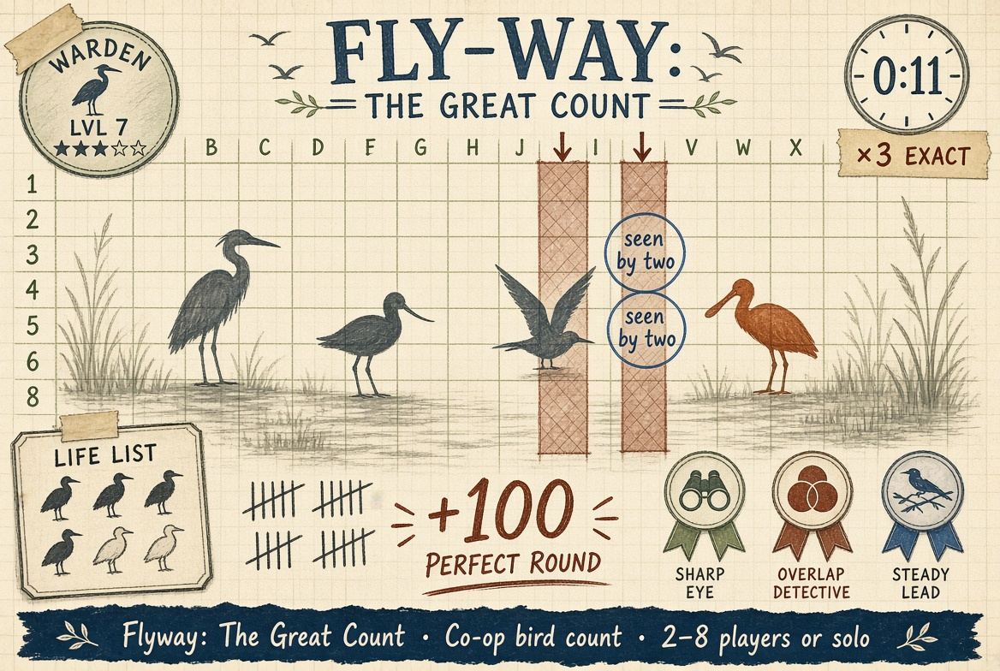

# Flyway: The Great Count



**Play now:** https://flyway-y5or.onrender.com/ (enter a name and tap **Practice** to play alone with two bot observers)

A cooperative bird-counting game for 2–8 observers. Each observer watches one sector of a dawn marsh. Neighbouring sectors overlap, so the same bird can appear in two notebooks. The team must report the true number of herons, avocets and terns without counting any bird twice, and find the one rare spoonbill.

## Run locally

Requires Node.js 18 or newer. No packages to install.

```sh
npm start
```

Open `http://localhost:3003`. Others join with the four-letter count code, or tap **Practice** to play with two bot observers.

## Rules

| Phase | Time | What happens |
|---|---|---|
| Scout | 75s | Study your sector, tally targets and how many sit in the hatched shared strip, share to the Team Sheet |
| Lock-in | 25s | The Lead Counter (rotates each round) sets the totals and the spoonbill cell. Everyone sees the draft live and can back the Lead |
| Reveal | 15s | The whole marsh, double-counted birds ringed, decoys marked, score breakdown and notebook accuracy |
| Scores | 8s | Running total, then the next round |

Scoring per round: each species 100 − 25 per bird of error, +100 for the exact spoonbill cell, +100 for a perfect round. Five rounds with rising density; decoy egrets and dunlins from round 3.

## Included

- Seeded scene generator with the overlap guarantee and a solvability check: birds sit only where one or two observers can see them, so raw totals minus shared birds always equal the truth
- Each client receives only `{species, cell}` for its own sector; ids and true totals stay on the server until the reveal
- If time runs out, the Lead's current draft is filed. A departing Lead hands over with 15 extra seconds
- Practice bots share notebooks 20–40 seconds in with 85% tally accuracy and 80% overlap accuracy
- Hand-drawn SVG silhouettes, tally marks, taped index cards, awards (Sharp Eye, Overlap Detective, Steady Lead) and rank titles
- `/healthz` returns `ok` for uptime monitors
- Gamified layer (`fx.js`): a personal life list of the six species, field ranks from Novice Birder to Keeper of the Flyway, eight field badges, named round bumpers, birds landing one by one on the reveal, an exact-count streak and a shareable result card

Rooms are held in memory and reset when the server restarts.

Submission details (title, description, cover, link) are in [SUBMISSION.md](SUBMISSION.md).
